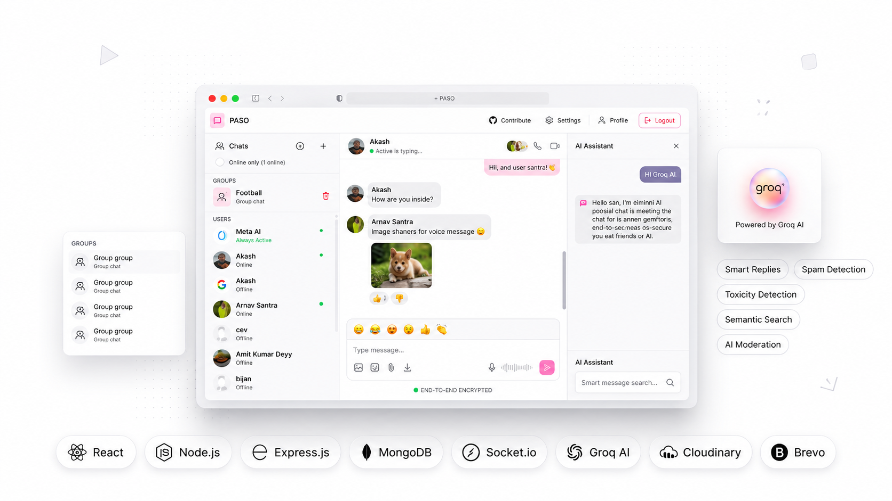
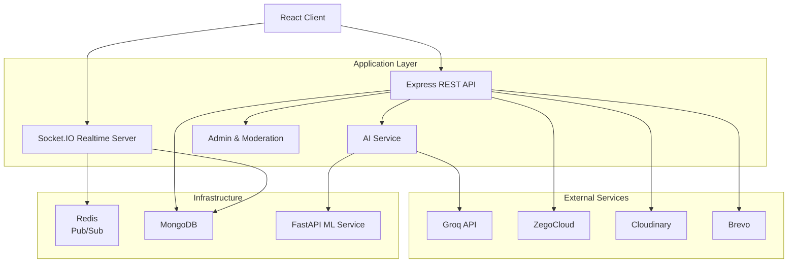

<p align="center">
  
</p>

<h1 align="center">
  PASO — AI-Powered Realtime Communication
</h1>

<p align="center">
  <b>
    A full-stack realtime communication platform combining messaging,
    voice/video calling, AI moderation, intelligent automation, and
    horizontally scalable Socket.IO infrastructure.
  </b>
</p>

<p align="center">
  <a href="https://chat-app-sooty-mu.vercel.app">
    
  </a>
  <a href="./docs/QUICK_START.md">
    
  </a>
  <a href="./LICENSE">
    
  </a>
</p>

<p align="center">
  
  
  
  
  
  
  
  
  
</p>

---

## Overview

PASO is a realtime communication platform built around a simple idea:

> **Communication should remain realtime, intelligent, and manageable as the system grows.**

The platform combines conventional chat functionality with distributed realtime infrastructure, AI-assisted communication, automated moderation, voice/video calling, and administrative controls.

It supports:

- Realtime 1:1 and group messaging
- Multi-instance Socket.IO communication through Redis
- AI-powered smart replies and moderation
- ML-based toxicity, spam, and intent analysis
- Voice and video calling
- File and media sharing
- Presence, typing indicators, and read receipts
- Role-based administration and moderation
- Analytics and audit workflows
- Automated frontend and backend CI validation

PASO was developed as part of **ECSoC 2026** and is designed as a practical demonstration of modern distributed web application architecture.

---

## Why PASO

Most realtime applications are straightforward while running on a single server. The engineering challenge becomes much more interesting when the application needs to maintain consistent state across multiple server instances while simultaneously handling authentication, messaging, presence, media, AI processing, and moderation.

PASO explores those problems through:

| Challenge | PASO Approach |
| --- | --- |
| Realtime communication | Socket.IO |
| Multi-instance synchronization | Redis Pub/Sub |
| Persistent application state | MongoDB |
| AI-assisted interactions | Groq API |
| Automated moderation | Python ML service |
| Voice/video communication | ZegoCloud |
| Media storage | Cloudinary |
| Authentication | JWT + refresh tokens |
| Authorization | Role-based access control |
| Abuse prevention | Rate limiting + validation |
| Operational visibility | Admin analytics + audit logs |
| Continuous validation | GitHub Actions |

---

## Quick Navigation

<p align="center">
  <a href="#overview">Overview</a> •
  <a href="#why-paso">Why PASO</a> •
  <a href="#features">Features</a> •
  <a href="#architecture">Architecture</a> •
  <a href="#technology-stack">Stack</a> •
  <a href="#quick-start">Quick Start</a> •
  <a href="#documentation">Documentation</a> •
  <a href="#deployment">Deployment</a> •
  <a href="#testing">Testing</a> •
  <a href="#roadmap">Roadmap</a>
</p>

---

## Features

<details>
<summary><b>Messaging & Realtime Communication</b></summary>

<br/>

- Realtime 1:1 messaging
- Group conversations and channels
- Message editing and deletion
- Emoji reactions
- Read and delivery receipts
- Typing indicators
- Online/offline presence
- Multi-device presence synchronization
- Conversation search
- Custom conversation wallpapers and themes
- Temporary status/stories with expiration
- Rich file and media attachments

</details>

<details>
<summary><b>AI & Machine Learning</b></summary>

<br/>

PASO combines external LLM capabilities with a dedicated ML service.

- AI-generated contextual reply suggestions
- Message toxicity scoring
- Spam classification
- Intent detection
- Automated moderation signals
- Policy-violation flagging
- AI-assisted administrative workflows
- Python-based inference service using FastAPI and Scikit-learn

The AI layer is intentionally separated from the primary API so that inference workloads do not have to be tightly coupled to the main application server.

</details>

<details>
<summary><b>Voice & Video</b></summary>

<br/>

- One-to-one voice calling
- Video calling
- Realtime call signaling
- WebRTC-based communication through ZegoCloud
- Call state synchronization
- Integrated calling experience inside conversations

</details>

<details>
<summary><b>Authentication & Security</b></summary>

<br/>

- JWT-based authentication
- Refresh token rotation
- Password hashing with bcrypt
- HTTP-only cookie protection
- Role-based access control
- Protected API routes
- Request validation and sanitization
- CORS protection
- Per-user and per-endpoint rate limiting
- Administrative moderation controls
- Audit logging for administrative actions

</details>

<details>
<summary><b>Administration & Moderation</b></summary>

<br/>

Administrators can manage the communication environment through dedicated workflows for:

- User management
- Reports and moderation queues
- Account warnings
- Temporary suspensions
- Content moderation
- System analytics
- Administrative audit logs
- Platform activity monitoring

</details>

<details>
<summary><b>Analytics & Platform Operations</b></summary>

<br/>

The administrative layer provides visibility into:

- User activity
- Messaging activity
- Moderation events
- Reports
- System usage
- Platform-level operational metrics

The architecture also supports centralized monitoring and external observability tooling in deployment environments.

</details>

---

## Architecture

PASO separates the realtime communication layer, REST API, AI/ML processing, persistence, and external integrations.



### Realtime Scaling

A key part of PASO is the separation between the Socket.IO server and the synchronization layer.

Instead of requiring every connected client to remain on the same application instance:

```text
Client
   │
   ▼
Socket.IO Instance A
   │
   ▼
Redis Pub/Sub
   │
   ▼
Socket.IO Instance B
   │
   ▼
Client
```

Redis provides the event propagation layer required for multiple Socket.IO instances to participate in the same realtime system.

This allows the realtime layer to scale horizontally behind a load balancer without making each instance an isolated communication island.

---

## Technology Stack

| Layer | Technology | Role |
| :--- | :--- | :--- |
| **Frontend** | React 18, Vite | Web application |
| **State Management** | Zustand | Client-side application state |
| **Styling** | Tailwind CSS | UI styling |
| **API** | Node.js, Express.js | REST API and business logic |
| **Realtime** | Socket.IO | WebSocket communication |
| **Pub/Sub** | Redis 7+ | Cross-instance realtime synchronization |
| **Database** | MongoDB 7+, Mongoose | Persistent application data |
| **Authentication** | JWT, bcrypt | Identity and authentication |
| **AI** | Groq API | LLM-powered features |
| **ML Service** | FastAPI, Scikit-learn | Moderation and classification |
| **Calling** | ZegoCloud | Voice/video communication |
| **Media** | Cloudinary | Media and asset storage |
| **Email** | Brevo | Transactional communication |
| **Testing** | Jest / Node.js testing tools | Automated validation |
| **CI/CD** | GitHub Actions | Build and test automation |
| **Frontend Hosting** | Vercel | Web deployment |
| **Backend Hosting** | Render | API deployment |

---

## Project Structure

```text
PASO/
├── frontend/
│   ├── src/
│   │   ├── components/          # Reusable UI components
│   │   ├── pages/               # Application pages
│   │   ├── store/               # Zustand state management
│   │   └── lib/                 # API and Socket.IO clients
│   ├── vite.config.js
│   └── tailwind.config.js
│
├── backend/
│   ├── src/
│   │   ├── controllers/         # Request handlers
│   │   ├── models/              # Mongoose models
│   │   ├── routes/              # REST API routes
│   │   ├── middleware/          # Auth, RBAC, rate limiting
│   │   ├── services/            # Application services
│   │   └── lib/                 # Database, Redis & Socket setup
│   └── test/                    # Backend tests
│
├── ml-service/
│   ├── app.py                   # FastAPI entry point
│   ├── requirements.txt         # Python dependencies
│   └── models/                  # ML model artifacts
│
├── docs/
│   ├── QUICK_START.md
│   ├── ARCHITECTURE.md
│   ├── API.md
│   ├── SOCKETS.md
│   ├── BACKEND.md
│   ├── FRONTEND.md
│   ├── ML_SERVICE.md
│   ├── DEPLOYMENT.md
│   ├── SCALING.md
│   ├── SECURITY_BEST_PRACTICES.md
│   ├── TESTING.md
│   ├── PERFORMANCE.md
│   ├── COPILOT_STORY.md
│   ├── CONTRIBUTOR_ONBOARDING.md
│   └── ROADMAP.md
│
├── .github/
│   └── workflows/
│       ├── frontend-ci.yml
│       └── backend-ci.yml
│
├── .env.example
├── package.json
├── LICENSE
└── README.md
```

---

## Quick Start

### Prerequisites

Make sure the following are installed:

- Node.js 18+
- npm
- Python 3.10+
- MongoDB 7+
- Redis 7+
- Git

External services such as Groq, ZegoCloud, Cloudinary, and Brevo are optional depending on which features you want to run locally.

### 1. Clone the repository

```bash
git clone https://github.com/CodePlaygroundHub/paso-chat-app.git
cd paso-chat-app
```

### 2. Configure the backend

```bash
cd backend
npm install
```

Create the environment file:

```bash
cp .env.example .env
```

Configure your database, authentication, Redis, and optional service credentials.

Start the backend:

```bash
npm run dev
```

The backend runs on:

```text
http://localhost:5001
```

### 3. Configure the frontend

Open another terminal:

```bash
cd frontend
npm install
```

Create the environment file:

```bash
cp .env.example .env
```

Configure the API URL:

```env
API_URL=http://localhost:5001
```

Start the frontend:

```bash
npm run dev
```

The frontend runs on:

```text
http://localhost:5173
```

### 4. Configure the ML service

```bash
cd ml-service
python -m venv venv
```

Activate the environment.

**Windows:**

```powershell
venv\Scripts\activate
```

**macOS / Linux:**

```bash
source venv/bin/activate
```

Install dependencies:

```bash
pip install -r requirements.txt
```

Start the service:

```bash
python app.py
```

The ML service runs on:

```text
http://localhost:5000
```

### 5. Verify the services

```bash
curl http://localhost:5001/health
curl http://localhost:5000/health
```

Then open:

```text
http://localhost:5173
```

---

## Environment Configuration

The exact variables depend on the enabled services.

Typical backend configuration:

```env
NODE_ENV=development

PORT=5001

MONGODB_URI=...

JWT_SECRET=...
JWT_REFRESH_SECRET=...

REDIS_URL=...

GROQ_API_KEY=...

CLOUDINARY_CLOUD_NAME=...
CLOUDINARY_API_KEY=...
CLOUDINARY_API_SECRET=...

BREVO_API_KEY=...

ZEGO_APP_ID=...
ZEGO_SERVER_SECRET=...
```

Frontend configuration:

```env
VITE_API_URL=http://localhost:5001
```

ML service configuration can be found in:

```text
ml-service/.env.example
```

**Never commit real API keys, database credentials, JWT secrets, or production environment files.**

---

## Running the Application

### Development

Backend:

```bash
cd backend
npm run dev
```

Frontend:

```bash
cd frontend
npm run dev
```

ML service:

```bash
cd ml-service
python app.py
```

### Production Frontend Build

```bash
cd frontend
npm run build
```

Preview the production build:

```bash
npm run preview
```

### Production Backend

```bash
cd backend
npm start
```

---

## Documentation

PASO keeps deeper implementation details outside the main README so the repository stays easy to navigate.

| Document | Description |
| :--- | :--- |
| [Quick Start](./docs/QUICK_START.md) | Local setup and verification |
| [Architecture](./docs/ARCHITECTURE.md) | Application architecture and design decisions |
| [API Reference](./docs/API.md) | REST API endpoints |
| [Socket Events](./docs/SOCKETS.md) | Socket.IO events and realtime contracts |
| [Backend Guide](./docs/BACKEND.md) | Backend services and implementation |
| [Frontend Guide](./docs/FRONTEND.md) | React architecture and state management |
| [ML Service](./docs/ML_SERVICE.md) | ML pipeline and inference service |
| [Deployment](./docs/DEPLOYMENT.md) | Cloud deployment configuration |
| [Scaling](./docs/SCALING.md) | Redis, Socket.IO and scaling strategy |
| [Security](./docs/SECURITY_BEST_PRACTICES.md) | Security controls and hardening |
| [Testing](./docs/TESTING.md) | Testing strategy and commands |
| [Performance](./docs/PERFORMANCE.md) | Performance and optimization notes |
| [Copilot Story](./docs/COPILOT_STORY.md) | AI-assisted development workflow |
| [Contributor Guide](./docs/CONTRIBUTOR_ONBOARDING.md) | Development and contribution setup |
| [Roadmap](./docs/ROADMAP.md) | Planned improvements |

---

## Deployment

The reference deployment uses:

| Component | Platform |
| :--- | :--- |
| Frontend | Vercel |
| Backend | Render |
| Database | MongoDB Atlas |
| Redis | Redis Cloud |
| ML Service | Separate Python service/container |
| Media | Cloudinary |
| Source Control | GitHub |
| CI/CD | GitHub Actions |

### Deployment Flow

```text
User
  │
  ▼
Vercel
  │
  │ HTTPS
  ▼
Render
  │
  ├──► MongoDB Atlas
  ├──► Redis
  ├──► ML Service
  ├──► Groq
  ├──► Cloudinary
  ├──► ZegoCloud
  └──► Brevo
```

For the complete deployment process, environment configuration, and production checklist:

**[Read the Deployment Guide](./docs/DEPLOYMENT.md)**

---

## Security

PASO implements security controls across authentication, authorization, API access, and administrative operations.

### Authentication

- JWT authentication
- Refresh token rotation
- bcrypt password hashing
- Protected routes
- Cookie-based protection where applicable

### Authorization

- Role-based access control
- Protected administrative routes
- Permission-aware API handlers
- User-level resource ownership checks

### API Protection

- Rate limiting
- Input validation
- Input sanitization
- CORS configuration
- Secure authentication middleware

### Administration

- User moderation workflows
- Account warnings
- Temporary suspensions
- Administrative audit logging

For detailed security considerations:

**[Security Best Practices](./docs/SECURITY_BEST_PRACTICES.md)**

---

## Testing

PASO uses automated testing to validate backend behavior and frontend builds.

### Backend Tests

```bash
cd backend
npm test
```

### Frontend Build

```bash
cd frontend
npm run build
```

### CI Validation

GitHub Actions maintains separate workflows for the frontend and backend:

```text
.github/
└── workflows/
    ├── frontend-ci.yml
    └── backend-ci.yml
```

The backend workflow validates the server test suite.

The frontend workflow validates the production Vite build.

See **[Testing](./docs/TESTING.md)** for the complete testing strategy.

---

## Performance & Scalability

PASO is designed around several principles that allow the communication layer to scale beyond a single application instance.

### Realtime Scaling

Socket.IO instances communicate through Redis Pub/Sub, allowing events to propagate between server instances.

### Data Layer

MongoDB provides persistent storage for users, conversations, messages, reports, and other application data.

### Caching & Ephemeral State

Redis can be used for high-frequency state such as:

- Presence
- Session-related data
- Realtime coordination
- Pub/Sub events
- Frequently accessed transient data

### Media

Cloudinary handles external media storage and delivery rather than placing large assets directly on application servers.

### ML Isolation

The ML inference layer runs separately from the primary Node.js API, keeping Python-based inference workloads isolated from the core application process.

For detailed performance considerations:

**[Performance Guide](./docs/PERFORMANCE.md)**

---

## Engineering Highlights

PASO focuses on several problems that commonly appear in production realtime systems:

### Distributed Realtime State

A single Socket.IO server is simple. Multiple instances require synchronization.

PASO uses Redis Pub/Sub to allow realtime events to propagate across instances.

### AI + Application Integration

AI features are treated as application services rather than isolated demonstrations.

The platform connects:

```text
User Message
     │
     ├──► Realtime Delivery
     │
     ├──► Toxicity Analysis
     │
     ├──► Spam Detection
     │
     ├──► Intent Detection
     │
     └──► AI-Assisted Response
```

### Separation of Responsibilities

The project separates:

- Frontend presentation
- REST API
- Realtime communication
- Business services
- ML inference
- Persistence
- External integrations

This makes individual components easier to test, replace, and scale independently.

---

## GitHub Copilot-Assisted Development

GitHub Copilot was used as a development accelerator throughout the project.

It assisted with:

- Initial architecture exploration
- Controller and model boilerplate
- Test generation
- Debugging
- Refactoring
- Documentation
- Repetitive implementation work

The engineering decisions, integration design, validation, and final implementation remain part of the project development process.

For the detailed development story:

**[Copilot Integration Story](./docs/COPILOT_STORY.md)**

---

## Roadmap

Planned improvements include:

- End-to-end message encryption
- Ephemeral message controls
- Advanced message search and filtering
- Voice message recording
- Improved media handling
- Location sharing
- Cloud backup and restore
- Expanded moderation models
- Native mobile clients
- More advanced realtime observability

See **[ROADMAP.md](./docs/ROADMAP.md)** for the detailed roadmap.

---

## Contributing

Contributions, issues, and technical discussions are welcome.

### Development Workflow

```bash
# Fork the repository

git clone https://github.com/CodePlaygroundHub/paso-chat-app.git

cd paso-chat-app

# Create a feature branch
git checkout -b feature/your-feature

# Make your changes

# Run tests
npm test

# Commit
git commit -m "Add your feature"

# Push
git push origin feature/your-feature
```

Then open a Pull Request.

Before contributing, read:

- [Contributor Onboarding](./docs/CONTRIBUTOR_ONBOARDING.md)
- [Development Workflow](./docs/DEV_WORKFLOW.md)
- [Code of Conduct](./CODE_OF_CONDUCT.md)

---

## Project Status

PASO is an actively developed full-stack project demonstrating:

- Realtime communication
- Distributed Socket.IO architecture
- Redis Pub/Sub
- AI-assisted communication
- ML-powered moderation
- Voice/video calling
- Secure authentication
- RBAC
- Administrative tooling
- Media handling
- Automated testing
- CI/CD

The project is primarily intended as a **technical demonstration and portfolio project**, while maintaining an architecture that reflects patterns used in production realtime applications.

---

## License

PASO is released under the **MIT License**.

See [`LICENSE`](./LICENSE) for the complete license text.

---

## Acknowledgements

PASO draws inspiration from the user experience and technical patterns found across modern communication platforms, including:

- WhatsApp — messaging experience
- Slack — collaborative communication
- Discord — realtime communities and calling
- Telegram — communication and security concepts

Third-party services used by PASO include Groq, ZegoCloud, Cloudinary, Brevo, MongoDB, Redis, and other open-source technologies.

---

## ⭐ Support the Project

If PASO was useful or interesting to you, consider giving the repository a ⭐.

Issues, ideas, and pull requests are always welcome.

## ⭐ Star History

<p align="center">
  <a href="https://github.com/CodePlaygroundHub/paso-chat-app/stargazers">
    
  </a>
</p>

<p align="center">
  <sub>
    Built with React, Node.js, Socket.IO, Redis, MongoDB, Python, and AI.
  </sub>
</p>
